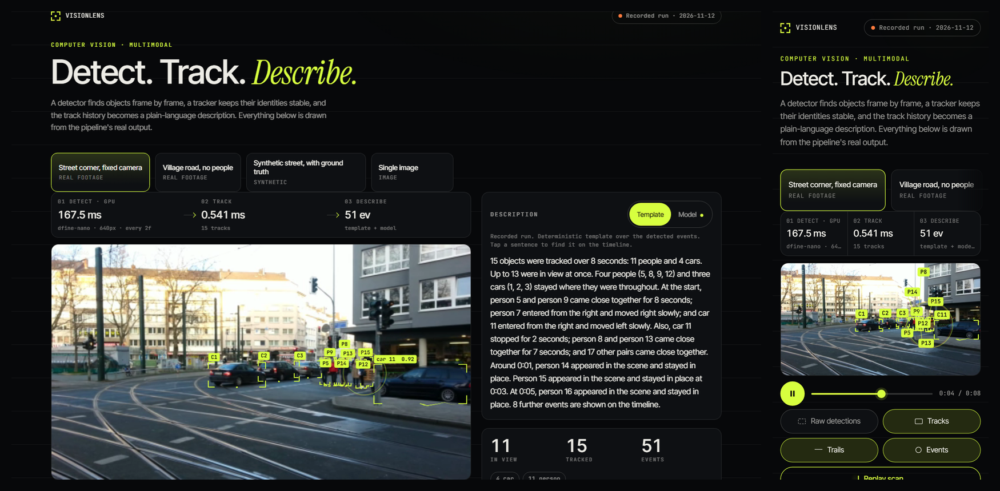
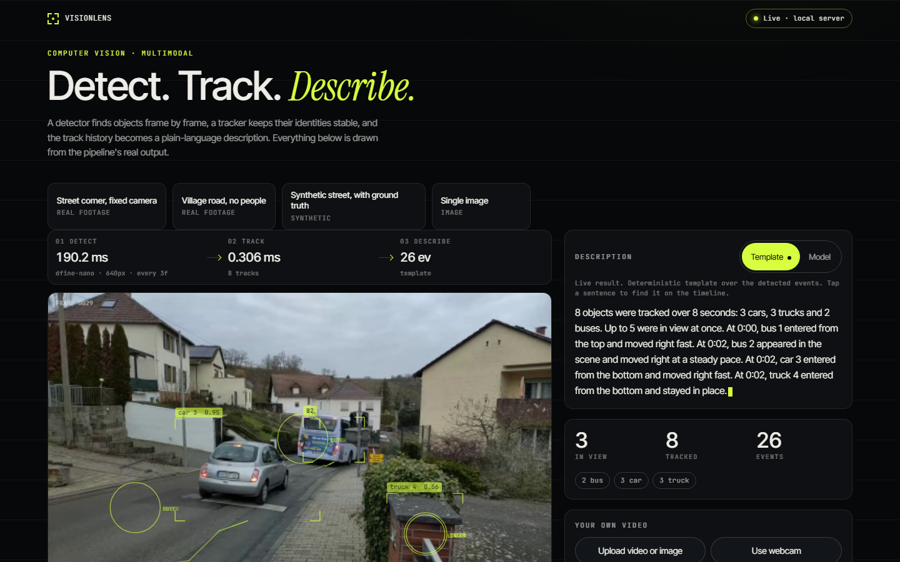
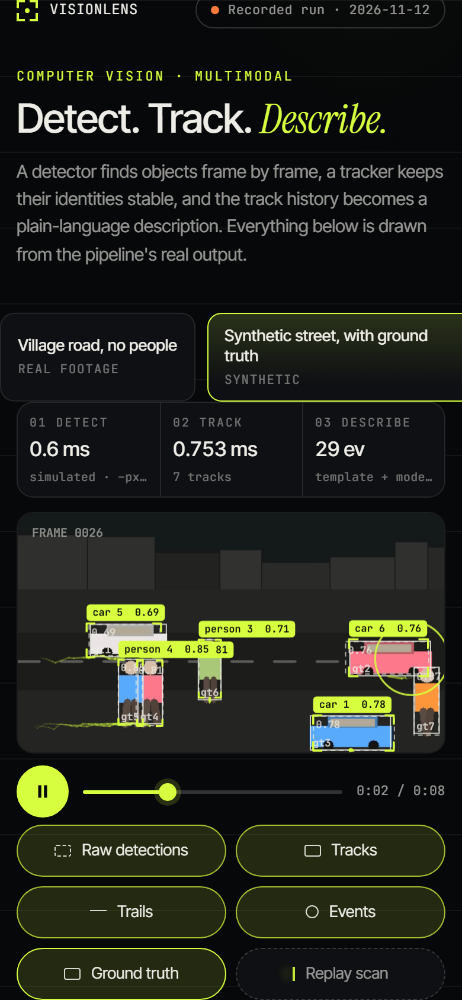
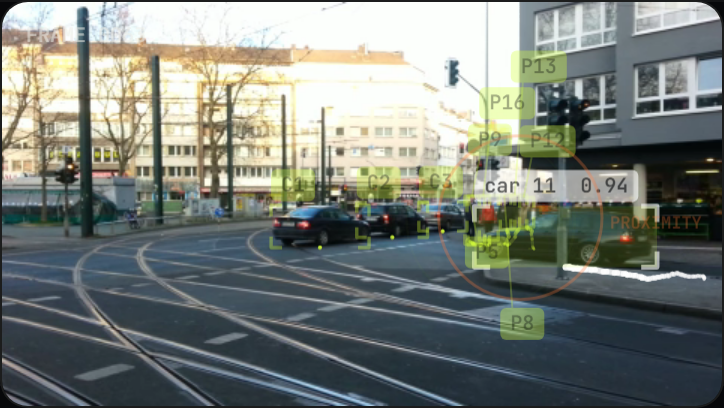
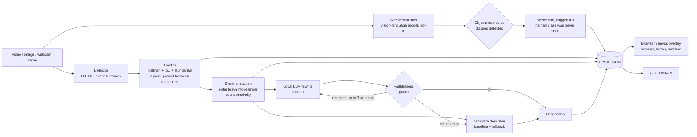

# VisionLens

[](https://github.com/Aditya2616/VisionLens/actions/workflows/ci.yml)
[](LICENSE)

By [Aditya Jain](https://adityajain16.vercel.app) and [Sneha Singh](https://github.com/snehasingh2608).

A multimodal pipeline that sees, labels and describes a scene: **detect, track, describe**.

A detection model finds objects frame by frame, a tracker I wrote keeps their identities stable, and the track
history is turned into a plain-language description. It runs offline, on a CPU or a GPU, with no API keys.

The tracking results are measured on synthetic scenes with exact ground truth only; there is no accuracy number for real footage (see Results).



Open the static demo (recorded runs of the real pipeline, no backend) by serving `docs/` with any static server; there is
no hosted copy yet, but the folder can be served by GitHub Pages. Run it live (upload, webcam, your own clips) with
`visionlens serve`.

Live mode (local server, your own upload, with the scene caption switched on) and the synthetic clip with the ground-truth layer:



 

## How it works

1. **Detect.** [D-FINE](https://arxiv.org/abs/2410.13842) nano (`ustc-community/dfine-nano-coco`) through Hugging Face
   Transformers. D-FINE small and RT-DETR r18vd are selectable for comparison; sizes, licences and published accuracy
   are in the models table below. The detector runs every N frames (the *stride*) and the tracker predicts the boxes
   in between.
2. **Track.** A ByteTrack-style tracker written from scratch: a Kalman filter per box, IoU plus the Hungarian
   algorithm (SciPy) for association, a second pass that rescues low-confidence boxes, class gating, and an optional
   OC-SORT-style re-update. No tracking library is used.
3. **Describe.** Deterministic event extraction (enter, leave, move, linger, count change, proximity) is the source of
   truth. A template summarises the events the way a person would: an opening sentence with the counts and the peak,
   then grouped statements ("Three cars (1, 2, 3) stayed where they were throughout"), then the notable individual
   events in time order, capped in length with the rest folded into a closing count. Every sentence keeps the ids of
   the events it states, so tapping it highlights them. Optionally a small local language model rewrites the text, and
   a **faithfulness guard** rejects any rewrite whose objects, counts, times, directions or event verbs are not
   supported by the event list. A rejected rewrite is regenerated (up to three attempts, with the guard's reason fed
   back) and, if it is still rejected, the template is shown.
4. **Scene (optional, opt-in).** A small vision-language model captions a few key frames and the middle frame's
   caption is shown as its own labelled line, "scene (vision-language model)", for what the events cannot know (the
   kind of place). It is never merged into the event sentences; if it names an object class the detector never saw in
   the clip, the result flags it.

The web page draws everything from the pipeline's real output (the scene line and the guard verdict included): a lime scanner sweep reveals each box with its label and
confidence, raw detections can be flipped against tracks to see what the tracker adds, tapping a box selects its track,
an event timeline scrubs and seeks, and a stage strip shows the measured milliseconds of each stage and the device the
detector ran on.

### Architecture



The result JSON (`src/visionlens/schemas.py`) is the one contract between the core, the CLI, the API, the page and the
recorded demo. The server returns the original video plus per-frame JSON; the browser draws the overlay on a canvas.

### Models

<!-- RESULTS:models:start -->
| Hub id | Licence | Parameters (M) | Download | Published COCO AP (val) |
|---|---|---|---|---|
| `ustc-community/dfine-nano-coco` | Apache-2.0 | 3.8 | 15 MB | 42.8 ([source](https://github.com/Peterande/D-FINE)) |
| `ustc-community/dfine-small-coco` | Apache-2.0 | 10.4 | 42 MB | 48.5 ([source](https://github.com/Peterande/D-FINE)) |
| `PekingU/rtdetr_r18vd` | Apache-2.0 | 20.2 | 81 MB | 46.5 ([source](https://huggingface.co/PekingU/rtdetr_r18vd)) |
| `Qwen/Qwen2.5-0.5B-Instruct` | Apache-2.0 | 494 | 1.0 GB | n/a |
| `Qwen/Qwen2.5-1.5B-Instruct` | Apache-2.0 | 1544 | 3.1 GB | n/a |
| `HuggingFaceTB/SmolVLM-256M-Instruct` | Apache-2.0 | 256 | 518 MB | n/a |

Licence, parameters and download size are read from the Hugging Face hub on 2026-11-12 (`scripts/fetch_facts.py`). The AP figures are quoted from the sources linked, not measured here.
<!-- RESULTS:models:end -->

## Results

Every number in this section is generated from `results/results.json` (written by `visionlens bench`),
`data/facts.json` and the recorded demo files by `python scripts/update_readme.py`. `--check` and a test fail when
the README drifts from them.

**Devices.** The pipeline picks CUDA if PyTorch can see a GPU and the CPU otherwise. The CPU columns below are the
CPU claim: a dedicated CPU run with the thread count shown. The GPU columns are a second, labelled measurement
(float32 detector, float16 language model). The static demo was recorded with the detector and the model on the GPU,
so its stage timings are GPU timings; the page labels them "GPU" next to the detect timing.

**Machine.**
<!-- RESULTS:machine:start -->
AMD Ryzen 5 8500G w/ Radeon 740M Graphics, 12 logical cores (3 threads used for the CPU rows). PyTorch 2.11.0+cu128 (the CPU rows are forced onto the CPU), transformers 5.7.0, OpenCV 5.0.0, Python 3.13.15. GPU: NVIDIA GeForce RTX 5060 Ti. Measured on 2026-11-13.
<!-- RESULTS:machine:end -->

**Load observed by the benchmark itself**, sampled before and after each group. Each table below also states the
CPU-busy percentage during its own run; a figure counts as taken on a quiet machine when both samples are under 25%.
<!-- RESULTS:load:start -->
| Group | Before | After |
|---|---|---|
| describer | CPU 11% busy, GPU 0% busy, 1732 of 16311 MB of its memory in use | CPU 12% busy, GPU 0% busy, 4679 of 16311 MB of its memory in use |
| detectors | CPU 1% busy, GPU 0% busy, 803 of 16311 MB of its memory in use | CPU 10% busy, GPU 0% busy, 1356 of 16311 MB of its memory in use |
| pipeline | CPU 3% busy, GPU 0% busy, 1356 of 16311 MB of its memory in use | CPU 6% busy, GPU 0% busy, 1370 of 16311 MB of its memory in use |
| captioner | CPU 4% busy, GPU 0% busy, 1370 of 16311 MB of its memory in use | CPU 9% busy, GPU 0% busy, 1732 of 16311 MB of its memory in use |
<!-- RESULTS:load:end -->

### Detector speed

<!-- RESULTS:detectors:start -->
| Detector | Input px | Params (M) | CPU median ms | CPU p95 ms | CPU FPS | GPU median ms / FPS | Dets/frame |
|---|---|---|---|---|---|---|---|
| dfine-nano | 640 | 3.8 | 120.8 | 151.4 | 8.28 | 52.3 ms / 19.12 | 44.51 |
| dfine-nano | 480 | 3.8 | 71.0 | 83.7 | 14.09 | 44.7 ms / 22.35 | 42.11 |
| dfine-nano | 320 | 3.8 | 47.4 | 53.6 | 21.09 | 33.3 ms / 30.05 | 26.68 |
| dfine-small | 640 | 10.4 | 243.0 | 269.3 | 4.12 | 46.9 ms / 21.33 | 47.16 |
| rtdetr-r18 | 640 | 20.2 | 366.5 | 414.8 | 2.73 | 35.8 ms / 27.91 | 29.89 |

One detector call on a 480x270 frame of the intersection clip (resized to the input size), batch 1, 37 frames, per-call time includes pre- and post-processing. CPU columns: 3 threads, float32, measured on a quiet machine, the CPU about 6% busy (sampled 1% before, 10% after). GPU column: NVIDIA GeForce RTX 5060 Ti, float32, GPU about 0% busy (idle).
<!-- RESULTS:detectors:end -->

### End to end, on a real clip

<!-- RESULTS:pipeline:start -->
CPU row: 3 threads, measured on a quiet machine, the CPU about 4% busy (sampled 3% before, 6% after). GPU row: float32 detector, GPU about 0% busy (idle).

| Detector on | Clip | Frames | Detector | Input | Stride | Detector calls | Detect ms (mean / p95) | Track ms (mean) | End-to-end FPS |
|---|---|---|---|---|---|---|---|---|---|
| CPU | intersection.webm | 80 | dfine-nano | 640px | 3 | 27 | 109.5 / 125.4 | 0.304 | 26.43 |
| GPU | intersection.webm | 80 | dfine-nano | 640px | 3 | 27 | 41.0 / 51.4 | 0.262 | 68.31 |
<!-- RESULTS:pipeline:end -->

### Tracking quality (synthetic scenes with exact ground truth)

<!-- RESULTS:tracker_setup:start -->
4 scene types x 3 seeds, 10 s at 15 fps, 9233 ground-truth boxes in total. Detections are the exact ground truth plus injected noise (see `NoiseConfig`); these are **synthetic-scene results, not MOT-benchmark results**. IDsw is the mean number of identity switches per scene.
<!-- RESULTS:tracker_setup:end -->

<!-- RESULTS:tracker_headline:start -->
At noise level 2 and detector stride 3 the tracker scores IDF1 0.871 and HOTA 0.693, against IDF1 0.287 and HOTA 0.269 for the naive per-frame IoU baseline (0.917 identity switches per scene against 43.25). Without the low-score second pass it scores IDF1 0.85.
<!-- RESULTS:tracker_headline:end -->

I wrote MOTA, IDF1, HOTA (DetA, AssA), ID switches and fragmentation myself (`src/visionlens/metrics.py`) and tested
them against hand-computed cases. The scenes are rendered by `visionlens.synth` (crossing, occlusion, crowd, street)
so the ground truth is exact. This is deliberately **not** a MOT17 or MOT20 result: those datasets are
non-commercially licensed and are not used. Synthetic scenes are easier than real footage.

Noise sweep (detector stride 3):

<!-- RESULTS:noise_sweep:start -->
| Noise level | Stride | MOTA | IDF1 | HOTA | DetA | AssA | IDsw |
|---|---|---|---|---|---|---|---|
| 0 | 3 | 0.877 | 0.914 | 0.842 | 0.849 | 0.835 | 0.5 |
| 1 | 3 | 0.855 | 0.864 | 0.76 | 0.788 | 0.735 | 1.083 |
| 2 | 3 | 0.824 | 0.871 | 0.693 | 0.7 | 0.687 | 0.917 |
| 3 | 3 | 0.655 | 0.733 | 0.519 | 0.528 | 0.513 | 4.0 |
<!-- RESULTS:noise_sweep:end -->

Detector stride sweep (noise level 2):

<!-- RESULTS:stride_sweep:start -->
| Noise level | Detector stride | MOTA | IDF1 | HOTA | DetA | AssA | IDsw |
|---|---|---|---|---|---|---|---|
| 2 | 1 | 0.899 | 0.793 | 0.713 | 0.796 | 0.644 | 3.083 |
| 2 | 2 | 0.864 | 0.854 | 0.711 | 0.746 | 0.68 | 2.0 |
| 2 | 3 | 0.824 | 0.871 | 0.693 | 0.7 | 0.687 | 0.917 |
| 2 | 5 | 0.533 | 0.69 | 0.536 | 0.471 | 0.617 | 2.667 |
| 2 | 8 | 0.111 | 0.331 | 0.276 | 0.208 | 0.379 | 4.0 |
<!-- RESULTS:stride_sweep:end -->

Ablation (noise level 2, stride 3):

<!-- RESULTS:ablation:start -->
| Variant | Noise level | Stride | MOTA | IDF1 | HOTA | DetA | AssA | IDsw |
|---|---|---|---|---|---|---|---|---|
| ByteTrack-style (default) | 2 | 3 | 0.824 | 0.871 | 0.693 | 0.7 | 0.687 | 0.917 |
| no low-score second pass | 2 | 3 | 0.811 | 0.85 | 0.67 | 0.684 | 0.658 | 1.417 |
| + observation-centric re-update | 2 | 3 | 0.824 | 0.871 | 0.692 | 0.699 | 0.686 | 0.917 |
| no class gating | 2 | 3 | 0.822 | 0.869 | 0.691 | 0.698 | 0.685 | 1.25 |
| no confirmation delay (min_hits=1) | 2 | 3 | 0.818 | 0.87 | 0.704 | 0.702 | 0.708 | 1.417 |
| naive IoU baseline (no motion model) | 2 | 3 | 0.634 | 0.287 | 0.269 | 0.531 | 0.139 | 43.25 |
<!-- RESULTS:ablation:end -->

Per scene (default tracker):

<!-- RESULTS:per_scene:start -->
| Scene | Noise level | Stride | MOTA | IDF1 | HOTA | DetA | AssA | IDsw |
|---|---|---|---|---|---|---|---|---|
| crossing | 2 | 3 | 0.791 | 0.783 | 0.652 | 0.676 | 0.629 | 2.0 |
| occlusion | 2 | 3 | 0.814 | 0.882 | 0.685 | 0.694 | 0.676 | 0.667 |
| crowd | 2 | 3 | 0.814 | 0.903 | 0.699 | 0.688 | 0.711 | 0.667 |
| street | 2 | 3 | 0.876 | 0.916 | 0.736 | 0.741 | 0.731 | 0.333 |
<!-- RESULTS:per_scene:end -->

### The language-model rewrite and the guard

The facts reach the model as a compact structured list ("- 0:03: person 15 appeared in the scene and stayed in
place"), with a prompt that asks for a short natural paragraph. If the guard rejects the paragraph it is
regenerated, up to three attempts in all, with the guard's reason and the offending sentence in the conversation.

<!-- RESULTS:describer:start -->
15 cases: 12 synthetic scenes (every scene type x 3 seeds, simulated detector) and the 3 recorded clips. The facts go to the model as a compact structured list; a rewrite the guard rejects is regenerated, up to 3 attempts in all, with the guard's reason and the offending sentence fed back. Greedy decoding.

| Model | Accepted on the first try | Accepted after retries | Mean attempts | Mean time per clip, GPU | Mean time per clip, CPU |
|---|---|---|---|---|---|
| Qwen/Qwen2.5-0.5B-Instruct | 9 / 15 (60%) | 9 / 15 (60%) | 1.8 | 5.33 s (cuda, float16) | 12.37 s, 1.0 attempts (cpu, float32, 3 cases, CPU 4.8% busy) |
| Qwen/Qwen2.5-1.5B-Instruct | 7 / 15 (47%) | 13 / 15 (87%) | 1.8 | 7.07 s (cuda, float16) | 54.37 s, 2.0 attempts (cpu, float32, 3 cases, CPU 8.2% busy) |
<!-- RESULTS:describer:end -->

How the results read, measured objectively on the same cases:

<!-- RESULTS:describer_readability:start -->
Means over the same cases. Repeated openings counts neighbouring sentences that start with the same word.

| Text | Sentences | Words | Words per sentence | Repeated openings |
|---|---|---|---|---|
| Template | 8.87 | 143.13 | 16.19 | 0.0 |
| `Qwen2.5-0.5B-Instruct`, text shown (accepted rewrite, else the template) | 7.0 | 110.2 | 16.47 | 0.93 |
| `Qwen2.5-0.5B-Instruct`, accepted rewrites only | 5.78 | 94.67 | 17.32 | 1.56 |
| `Qwen2.5-1.5B-Instruct`, text shown (accepted rewrite, else the template) | 7.0 | 100.47 | 15.07 | 0.13 |
| `Qwen2.5-1.5B-Instruct`, accepted rewrites only | 6.69 | 93.54 | 14.9 | 0.15 |
<!-- RESULTS:describer_readability:end -->

Why attempts were rejected (counted over all attempts of both models):
<!-- RESULTS:describer_reasons:start -->
25 x wrong or invented count, 3 x event verb not supported by the events, 3 x direction contradicts the events, 1 x object that was not tracked
<!-- RESULTS:describer_reasons:end -->

What the guard checks, per sentence, against the typed event list and not against the template wording: every object
mentioned exists with that class and group counts match the ids listed; counts and numbers appear in the facts; times
lie within a second of an event of the objects mentioned; directions agree ("from the left" with the entry edge,
"toward the right" with the exit edge or direction of travel, "moved right" with the direction); event verbs
(entered, left, stayed or stopped, moved, came close together) are supported by an event of that kind. Tests feed it
deliberately corrupted rewrites (flipped direction, wrong count, invented object, wrong time, an exit that never
happened) and it must reject each one (`tests/test_describe_grouping.py`), and they check the regenerate-on-rejection
loop (`tests/test_caption_and_retry.py`).

It is still a lexical parser, not a proof. It cannot see an invented setting ("a busy city street"), and a rewrite
that keeps every id, number, direction and verb consistent but drops or reorders facts passes.

<!-- RESULTS:retry_effect:start -->
Effect of the retries: for `Qwen2.5-0.5B-Instruct` retries did not change acceptance (9 of 15; mean 1.8 attempts); in 6 of its 6 final rejections every attempt failed for the same reason; for `Qwen2.5-1.5B-Instruct` retries moved acceptance from 7 of 15 cases on the first try to 13 of 15 (mean 1.8 attempts); in 1 of its 2 final rejections every attempt failed for the same reason.
<!-- RESULTS:retry_effect:end -->

<!-- RESULTS:describer_choice:start -->
**Choice by evidence.** The best model is `Qwen/Qwen2.5-1.5B-Instruct`: accepted on 13 of 15 cases after retries (threshold 90%: not met), repeated openings 0.13 against the template's 0.0 (not met), words 100.47 against 143.13 (met). The rewrite does not pass all three tests, so the template stays the default describer and the rewrite is an option.
<!-- RESULTS:describer_choice:end -->
In the recorded demo the Template tab opens first; the Model tab shows the real rewrite of each clip with the
guard verdict and the number of attempts, or the labelled fallback when the guard rejected it.

### The scene captioner

<!-- RESULTS:captioner:start -->
16 cases (the 3 recorded clips, the recorded image and all 12 synthetic scenes), three key frames per clip (10%, 50% and 90% of its length); the shown caption is the middle frame's, cut at its first full stop. Rubric, applied automatically: (1) the caption names the setting correctly (it contains a word from the list for that case, below), (2) it names an object class (person, car, bus, ...) that the detector never saw in that clip, (3) it is one complete sentence of at least four words.

| Prompt | Setting named correctly (all) | Setting named correctly (3 real captures) | Names an unseen class | One complete sentence | Mean time per clip |
|---|---|---|---|---|---|
| A | 7 / 16 | 3 / 3 | 0 / 16 | 14 / 16 | 1.5 s (cuda, float16) |
| B | 6 / 16 | 2 / 3 | 0 / 16 | 0 / 16 | 0.83 s (cuda, float16) |
| C (chosen) | 10 / 16 | 3 / 3 | 0 / 16 | 16 / 16 | 2.27 s (cuda, float16) |

Word lists for rubric (1) (`SETTING_WORDS` in `src/visionlens/bench.py`):
- intersection: street, road, intersection, junction, crossroads, crossing, city, urban, tram, traffic
- traffic: street, road, village, town, residential, neighbourhood, neighborhood, suburb, lane
- still: street, road, village, town, residential, neighbourhood, neighborhood, suburb, lane
- synthetic-street: street, road, city, urban, town, crosswalk, sidewalk, crossing
- synthetic-plaza: city, urban, town, plaza, square, courtyard, buildings, night, dark, street, road

Prompts:
- **A**: “Describe the place in this image in one short sentence: the kind of setting and the main things you can see. Do not describe individual people.”
- **B**: “What kind of place is this? Answer with one short sentence that names the place and the main things in it.”
- **C**: “Describe the setting of this image in one complete sentence of at least eight words: what kind of place it is and what is in it.”

Time per clip (three key frames) for prompt C: 2.27 s on cuda (float16) over 16 cases, 6.23 s on the cpu (float32) over 3 cases with the CPU 13.0% busy.
<!-- RESULTS:captioner:end -->

The captions the evaluation run produced for the recorded clips (the chosen prompt; the recorded demo has its own
captions, taken from its own key frames and shown in the table below):

<!-- RESULTS:caption_examples:start -->
| Recorded clip | Caption shown | Setting named correctly |
|---|---|---|
| intersection | The image depicts an urban street scene with a focus on a busy intersection. | yes |
| traffic | The image depicts a street scene in a quaint town. | yes |
| synthetic | The image is a cartoon-style illustration of a city street. | yes |
| still | The image depicts a residential area with a mix of residential buildings and a few commercial establishments. | yes |
<!-- RESULTS:caption_examples:end -->

<!-- RESULTS:caption_trust:start -->
**How far to trust it.** On the 3 real captures (two clips and the image) it named the kind of place correctly in 3 of 3; over all 16 cases it named a class the detector never saw in 0. On the 12 rendered scenes it passed the setting test in 6. For the 9 plaza-like scenes (dark open ground with building silhouettes) it wrote 5 different captions: “The image shows a group of four people standing together on a dark, possibly nighttime, stage.”; “The image shows a group of people standing in a circle, seemingly in a communal or collective setting.”; “The image shows a group of people, each holding a different piece of a puzzle, arranged in a circle.”; “The image shows a group of people, each holding a puzzle piece, arranged in a circle.”; “The image shows a scene from a video game, specifically a level where players need to solve puzzles to progress.”.
<!-- RESULTS:caption_trust:end -->

It is opt-in (`--caption`, or the "Scene caption" dropdown in live mode) because it needs a second model and costs
seconds per clip; it is not part of the event description and does not change it. A caption can still be wrong in ways
the class cross-check cannot see (the setting, the weather, how many things there are), so it is shown as a separate,
labelled line.

### The recorded demo

The page replays these files from `docs/demo/`; the counts, timings and device in its stage strip and counters are
read from the same JSON.

<!-- RESULTS:demo:start -->
Recorded on 2026-11-12 with dfine-nano at stride 2; detector device: cuda (NVIDIA GeForce RTX 5060 Ti), language model in float16, captioner in float16.

| Clip | Length | Tracks | Events | Detect, mean per call | Model rewrite | Scene caption (vision-language model) | Video + JSON |
|---|---|---|---|---|---|---|---|
| Street corner, fixed camera | 80 frames, 8 s | 15 | 51 | 175.4 ms (GPU) | rejected ('the left' disagrees with the exit edge or direction of travel), template shown | “The image depicts an urban street scene with a focus on a busy intersection.” | 1.55 MB |
| Village road, no people | 80 frames, 8 s | 8 | 27 | 53.2 ms (GPU) | accepted | “The image depicts a street scene in a residential area, likely in a suburban or small town setting.” | 1.45 MB |
| Synthetic street, with ground truth | 80 frames, 8 s | 7 | 29 | 0.5 ms (simulated detector) | accepted | “The image is a scene from a street scene, featuring a group of people standing on the road.” | 0.18 MB |
| Single image | image | n/a | n/a | 59.9 ms (GPU) | none | “The image depicts a residential area with a mix of residential buildings and a few commercial establishments.” | 0.03 MB |
<!-- RESULTS:demo:end -->

These timings come from a recording made while the GPU was shared; see Limitations.

## Quickstart

Python 3.10 or later (developed on 3.13). `pip` installs PyTorch and a matching torchvision; a CPU build is enough.

```bash
git clone https://github.com/Aditya2616/VisionLens.git
cd VisionLens
python -m venv .venv
. .venv/bin/activate            # Windows: .venv\Scripts\activate
pip install -e .
visionlens fetch-models         # one-time download of the models
visionlens serve                # http://127.0.0.1:8106
```

<!-- RESULTS:downloads:start -->
`visionlens fetch-models` downloads the default detector (15 MB). `--llm` adds the optional rewrite model, Qwen2.5-1.5B-Instruct (3.1 GB), `--caption` adds the optional scene captioner, SmolVLM-256M-Instruct (518 MB; only the weights and tokenizer files, not the repository's ONNX exports), and `--all` fetches everything in the models table (4.8 GB in total).
<!-- RESULTS:downloads:end -->

```bash
visionlens run docs/demo/traffic.webm                  # writes outputs/traffic.visionlens.json and prints the description
visionlens run docs/demo/traffic.webm --describer llm # plus the local model rewrite and the guard verdict
visionlens run docs/demo/traffic.webm --caption        # plus the scene line from the vision-language model
visionlens run docs/demo/still.jpg                     # a single image
visionlens annotate docs/demo/traffic.webm outputs/traffic.visionlens.json   # draws boxes and ids into outputs/traffic.annotated.webm
```

`--out` changes where `run`, `annotate` and `make-synthetic` write; the default is `outputs/` (git-ignored) so nothing
lands in the folder of the input. `--device cpu|cuda|auto` picks the device (default: CUDA when PyTorch can see a
GPU, otherwise the CPU).

## Reproduce and test

`visionlens bench` writes every number in the Results section to `results/results.json`; `scripts/update_readme.py` regenerates the README blocks from it.

```bash
visionlens bench --out results/results.json            # runs every benchmark (GPU and CPU, several minutes)
pytest && ruff check .                                 # fast tests; `pytest -m slow` runs the real-model tests
python scripts/update_readme.py --check                # fails if the README numbers drift from their sources
```

The fast tests never load a model; `pytest -m slow` runs the real-model tests. The UI is checked with headless Chromium by `scripts/ui_check.py` (`--mode static` for the recorded demo, `--mode live` for upload, sample runs and the webcam).

## Layout

```
src/visionlens/    detect/ track/ describe/ events.py pipeline.py synth.py metrics.py bench.py api.py cli.py ...
tests/             fast offline tests (pytest); real-model tests are marked slow
docs/              the web page (served by the API and by GitHub Pages) and the recorded demo in docs/demo/
docs/notes/        my research notes and design spec
scripts/           fetch_samples.py, fetch_facts.py, ui_check.py and screenshots.py (headless Chromium), static_server.py, update_readme.py
data/              samples.json (clip credits), facts.json (model licences, sizes, published accuracy)
results/           results.json, the output of `visionlens bench`
```

## Static demo

Without the server, the demo in `docs/` works as a plain static site. It has to be served over HTTP, not opened as a
file, so the video and JSON can load, and the server must support range requests so the video can seek:
`python scripts/static_server.py 8000 docs`.

| | Local server (`visionlens serve`) | Static `docs/` (GitHub Pages) |
|---|---|---|
| Recorded clips with scanner, toggles, timeline | yes | yes |
| Run a bundled clip live | yes | no (explained on the page) |
| Upload a video or image | yes | no |
| Webcam | yes, only after you tap the button | no |

<!-- RESULTS:limits:start -->
Uploads are capped at 40 MB; only the first 20 s are analysed, at up to 640 px wide. They are written to a temporary folder and deleted when processing ends.
<!-- RESULTS:limits:end -->
The webcam starts only after an explicit tap; frames are processed on your machine and not stored.

### Browser support

- **Chromium:** VP9 WebM plays; checked with headless Chromium at 1440x900 and at 390x844 with touch.
- **Safari:** per [caniuse](https://caniuse.com/webm) (WebM video format), Safari supports WebM from 14.1 on macOS 11.3
  and later and from 17.4 on iOS. I checked the demo by hand in Safari on iPhones and it plays; I have not tested
  Safari on a Mac.
- **Fallback for browsers without VP9 WebM:** the page shows a frame sequence (a sprite sheet of 5 frames per second
  drawn on a canvas) so the demo is never blank; the overlay and timeline work the same, but the picture is lower
  resolution and choppier. I tested it by forcing it (`?player=sprite`) in Chromium and in Playwright's WebKit build with
  the iPhone 14 profile and at 1440x900 on 2026-11-13: no console errors, no horizontal scroll, and tap play, box
  selection, timeline seek and clip switching all work, with boxes matching Chromium's. The WebM video path could not be
  checked in that WebKit build (Windows), because it cannot play any media; that path is covered by the hand check on
  iPhones above.
- **Playback** always starts from a tap; nothing autoplays.

## Design decisions

- **Stride detection.** At CPU speeds a detector cannot run on every frame of a 15 fps clip. Running it every few
  frames and letting the Kalman filter predict in between is what makes the tracker necessary, and the stride sweep
  above shows what it costs in identity quality.
- **Own tracker, own metrics.** Both are small enough to test properly: Kalman convergence, assignment, birth and
  death, occlusion recovery, identity stability on crossing paths, class gating, and the second pass beating a single
  pass on noisy input.
- **Events first.** The description is derived from typed events, not from pixels. The language model can only rephrase
  them, and the guard checks the rephrasing.
- **The browser draws the overlay.** OpenCV here cannot encode H.264, so annotated video would have to be VP9 WebM.
  Drawing in the browser avoids that, makes the layer toggles free and lets the static site work.
- **No Ultralytics YOLO.** Its AGPL licence is incompatible with an MIT repository; D-FINE and RT-DETR are
  Apache-2.0.
- **The captioner is opt-in and kept apart.** The site promises a multimodal pipeline, and events cannot say what kind
  of place a clip shows, so a small vision-language model captions a few key frames. Its line is labelled, separate
  from the event sentences, cross-checked against the detector's classes, and off by default because of its cost.

## Limitations

- D-FINE nano is small. It misses far-away or heavily occluded people and gives some false positives; the intersection
  clip shows this.
- The tracker has no appearance model, so identities can swap when objects cross closely for a long time.
- Real footage has no ground truth here, so there is no accuracy number for it. Tracking numbers are synthetic only.
- The local Qwen2.5 models are slow on a CPU; the rewrite is a guarded option, and by the evidence above it is not the
  default describer.
- The scene captioner is a 256 M-parameter model; its captions are generic, it fails the word-list test on the
  plaza-like rendered scenes, and the cross-check only covers detector classes (person, car, bus, and so on).
- The benchmark timings were taken on an otherwise idle machine (the date is in the Machine block); the load tables above give the CPU and GPU load seen during each run. The stage timings in the recorded demo come from its own earlier recording (see The recorded demo), made while the GPU was shared with other jobs, and are not benchmark figures.
- The hosted describers (OpenAI, Anthropic; see `.env.example`) take their key and model id from `OPENAI_API_KEY` and
  `OPENAI_MODEL`, or `ANTHROPIC_API_KEY` and `ANTHROPIC_MODEL` (or a constructor argument). There is no default model
  id, and selecting one without it gives a clear configuration error (the description then falls back to the
  template). They are adapters tested against a stubbed HTTP transport only; I have not run them against the real
  services.
- Tested paths that ran for real: D-FINE nano, small and RT-DETR r18vd inference, the local Qwen2.5 rewrites, the
  SmolVLM captioner, the server, uploads, and the webcam under Chromium's fake camera.

## Credits and licences

Code: MIT, copyright Aditya Jain.

- Models: D-FINE (Peng et al.) and RT-DETR weights from the Hugging Face hub, Qwen2.5 for the optional rewrite and
  SmolVLM for the optional scene caption;
  licences are in the models table above. Weights are downloaded, never committed.
- Sample clips, all CC0 from Wikimedia Commons (credits also in the page footer and `data/samples.json`):
<!-- RESULTS:credits:start -->
  - Street corner, fixed camera: [Straßenverkehr in Düsseldorf.ogv](https://commons.wikimedia.org/wiki/File:Stra%C3%9Fenverkehr_in_D%C3%BCsseldorf.ogv) by Slick, CC0; an excerpt of 8 s starting at 3.0 s, resized to 480 px wide and re-encoded as VP9 WebM.
  - Village road, no people: [Gau-Bischofsheim - Steigstraße, Ampelschaltung auf Rot.webm](https://commons.wikimedia.org/wiki/File:Gau-Bischofsheim_-_Steigstra%C3%9Fe,_Ampelschaltung_auf_Rot.webm) by ManuelB701, CC0; an excerpt of 8 s starting at 2.0 s, resized to 480 px wide and re-encoded as VP9 WebM.
<!-- RESULTS:credits:end -->
- The synthetic clip is generated by this repository, and the single-image sample is a frame of the village-road clip.

Built by [Aditya Jain](https://adityajain16.vercel.app) and [Sneha Singh](https://github.com/snehasingh2608).
