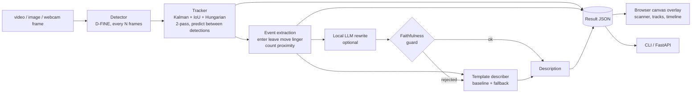

# VisionLens

A multimodal pipeline that sees, labels and describes a scene: **detect, track, describe**.

A detection model finds objects frame by frame, a tracker I wrote keeps their identities stable, and the track
history is turned into a plain-language description. It runs offline, on a CPU or a GPU, with no API keys.


Open the static demo (recorded runs of the real pipeline, no backend) by serving `docs/` with any static server, or on
GitHub Pages. Run it live (upload, webcam, your own clips) with `visionlens serve`.

Live mode (local server, your own upload) and the synthetic clip with the ground-truth layer:


 

## What it does

1. **Detect.** [D-FINE](https://arxiv.org/abs/2410.13842) nano (`ustc-community/dfine-nano-coco`) through Hugging Face
   Transformers. D-FINE small and RT-DETR r18vd are selectable for comparison; sizes, licences and published accuracy
   are in the models table below. The detector runs every N frames (the *stride*) and the tracker predicts the boxes
   in between.
2. **Track.** A ByteTrack-style tracker written from scratch: a Kalman filter per box, IoU plus the Hungarian
   algorithm (SciPy) for association, a second pass that rescues low-confidence boxes, class gating, and an optional
   OC-SORT-style re-update. No tracking library is used.
3. **Describe.** Deterministic event extraction (enter, leave, move, linger, count change, proximity) is the source of
   truth. A template summarises the events the way a person would: an opening sentence with the counts and the peak,
   then grouped statements ("Three cars (1, 2, 3) stayed where they were throughout"), then the notable individual
   events in time order, capped in length with the rest folded into a closing count. Every sentence keeps the ids of
   the events it states, so tapping it highlights them. Optionally a small local language model rewrites the text, and
   a **faithfulness guard** rejects any rewrite whose objects, counts, times, directions or event verbs are not
   supported by the event list, falling back to the template.

The web page draws everything from the pipeline's real output: a lime scanner sweep reveals each box with its label and
confidence, raw detections can be flipped against tracks to see what the tracker adds, tapping a box selects its track,
an event timeline scrubs and seeks, and a stage strip shows the measured milliseconds of each stage and the device the
detector ran on.

## Architecture



The result JSON (`src/visionlens/schemas.py`) is the one contract between the core, the CLI, the API, the page and the
recorded demo. The server returns the original video plus per-frame JSON; the browser draws the overlay on a canvas.

## Quickstart

Python 3.10 or later (developed on 3.13). `pip` installs PyTorch and a matching torchvision; a CPU build is enough.

```bash
git clone https://github.com/Aditya2616/VisionLens.git
cd VisionLens
python -m venv .venv
. .venv/bin/activate            # Windows: .venv\Scripts\activate
pip install -e .
visionlens fetch-models         # one-time download of the models
visionlens serve                # http://127.0.0.1:8106
```

<!-- RESULTS:downloads:start -->
`visionlens fetch-models` downloads the default detector (15 MB). `--llm` also downloads the optional rewrite model, Qwen2.5-0.5B-Instruct (1.0 GB), and `--all` fetches both comparison detectors as well (1.1 GB in total).
<!-- RESULTS:downloads:end -->

```bash
visionlens run docs/demo/traffic.webm                  # writes outputs/traffic.visionlens.json and prints the description
visionlens run docs/demo/traffic.webm --describer llm # plus the local model rewrite and the guard verdict
visionlens run docs/demo/still.jpg                     # a single image
visionlens annotate docs/demo/traffic.webm outputs/traffic.visionlens.json   # draws boxes and ids into outputs/traffic.annotated.webm
visionlens bench --out results/results.json            # every number in the Results section
pytest && ruff check .                                 # fast tests; `pytest -m slow` runs the real-model tests
python scripts/update_readme.py --check                # fails if the README numbers drift from their sources
```

`--out` changes where `run`, `annotate` and `make-synthetic` write; the default is `outputs/` (git-ignored) so nothing
lands in the folder of the input. `--device cpu|cuda|auto` picks the device (default: CUDA when PyTorch can see a
GPU, otherwise the CPU).

Without the server, the demo in `docs/` works as a plain static site. It has to be served over HTTP, not opened as a
file, so the video and JSON can load, and the server must support range requests so the video can seek:
`python scripts/static_server.py 8000 docs`.

### Live mode and the static demo

| | Local server (`visionlens serve`) | Static `docs/` (GitHub Pages) |
|---|---|---|
| Recorded clips with scanner, toggles, timeline | yes | yes |
| Run a bundled clip live | yes | no (explained on the page) |
| Upload a video or image | yes | no |
| Webcam | yes, only after you tap the button | no |

<!-- RESULTS:limits:start -->
Uploads are capped at 40 MB; only the first 20 s are analysed, at up to 640 px wide. They are written to a temporary folder and deleted when processing ends.
<!-- RESULTS:limits:end -->
The webcam starts only after an explicit tap; frames are processed on your machine and not stored.

## Models

<!-- RESULTS:models:start -->
| Hub id | Licence | Parameters (M) | Download | Published COCO AP (val) |
|---|---|---|---|---|
| `ustc-community/dfine-nano-coco` | Apache-2.0 | 3.8 | 15 MB | 42.8 ([source](https://github.com/Peterande/D-FINE)) |
| `ustc-community/dfine-small-coco` | Apache-2.0 | 10.4 | 42 MB | 48.5 ([source](https://github.com/Peterande/D-FINE)) |
| `PekingU/rtdetr_r18vd` | Apache-2.0 | 20.2 | 81 MB | 46.5 ([source](https://huggingface.co/PekingU/rtdetr_r18vd)) |
| `Qwen/Qwen2.5-0.5B-Instruct` | Apache-2.0 | 494 | 1.0 GB | n/a |
| `Qwen/Qwen2.5-1.5B-Instruct` | Apache-2.0 | 1544 | 3.1 GB | n/a |

Licence, parameters and download size are read from the Hugging Face hub on 2026-11-12 (`scripts/fetch_facts.py`). The AP figures are quoted from the sources linked, not measured here.
<!-- RESULTS:models:end -->

## Results

Every number in this section is generated from `results/results.json` (written by `visionlens bench`),
`data/facts.json` and the recorded demo files by `python scripts/update_readme.py`. `--check` and a test fail when
the README drifts from them.

**Devices.** The pipeline picks CUDA if PyTorch can see a GPU and the CPU otherwise. The CPU columns below are the
CPU claim: a dedicated CPU run with the thread count shown. The GPU columns are a second, labelled measurement
(float32 detector, float16 language model). The static demo was recorded with the detector and the model on the GPU,
so its stage timings are GPU timings; the page labels them "GPU" next to the detect timing.

**Machine.**
<!-- RESULTS:machine:start -->
AMD Ryzen 5 8500G w/ Radeon 740M Graphics, 12 logical cores (3 threads used for the CPU rows). PyTorch 2.11.0+cu128 (the CPU rows are forced onto the CPU), transformers 5.7.0, OpenCV 5.0.0, Python 3.13.15. GPU: NVIDIA GeForce RTX 5060 Ti. Measured on 2026-11-12.
<!-- RESULTS:machine:end -->

**Load observed by the benchmark itself**, sampled before and after each group. Each table below also states the
CPU-busy percentage during its own run; an idle machine will be faster.
<!-- RESULTS:load:start -->
| Group | Before | After |
|---|---|---|
| describer | CPU 55% busy, GPU 83% busy, 13453 of 16311 MB of its memory in use | CPU 49% busy, GPU 84% busy, 12151 of 16311 MB of its memory in use |
| detectors | CPU 58% busy, GPU 83% busy, 12914 of 16311 MB of its memory in use | CPU 69% busy, GPU 82% busy, 13439 of 16311 MB of its memory in use |
| pipeline | CPU 65% busy, GPU 83% busy, 13439 of 16311 MB of its memory in use | CPU 59% busy, GPU 86% busy, 13453 of 16311 MB of its memory in use |
<!-- RESULTS:load:end -->

### Detector speed

<!-- RESULTS:detectors:start -->
| Detector | Input px | Params (M) | CPU median ms | CPU p95 ms | CPU FPS | GPU median ms / FPS | Dets/frame |
|---|---|---|---|---|---|---|---|
| dfine-nano | 640 | 3.8 | 149.4 | 190.8 | 6.69 | 105.2 ms / 9.51 | 44.51 |
| dfine-nano | 480 | 3.8 | 109.2 | 134.3 | 9.15 | 106.0 ms / 9.43 | 42.11 |
| dfine-nano | 320 | 3.8 | 63.2 | 83.5 | 15.82 | 88.9 ms / 11.25 | 26.68 |
| dfine-small | 640 | 10.4 | 419.1 | 576.5 | 2.39 | 97.6 ms / 10.25 | 47.16 |
| rtdetr-r18 | 640 | 20.2 | 545.7 | 608.0 | 1.83 | 67.6 ms / 14.8 | 29.89 |

One detector call on a 480x270 frame of the intersection clip (resized to the input size), batch 1, 37 frames, per-call time includes pre- and post-processing. CPU columns: 3 threads, float32, measured with the CPU about 63% busy with other work (sampled 58% before, 69% after); an idle machine will be faster. GPU column: NVIDIA GeForce RTX 5060 Ti, float32, GPU about 82% busy with other work.
<!-- RESULTS:detectors:end -->

### End to end, on a real clip

<!-- RESULTS:pipeline:start -->
CPU row: 3 threads, measured with the CPU about 62% busy with other work (sampled 65% before, 59% after); an idle machine will be faster. GPU row: float32 detector, GPU about 84% busy with other work.

| Detector on | Clip | Frames | Detector | Input | Stride | Detector calls | Detect ms (mean / p95) | Track ms (mean) | End-to-end FPS |
|---|---|---|---|---|---|---|---|---|---|
| CPU | intersection.webm | 80 | dfine-nano | 640px | 3 | 27 | 189.0 / 221.0 | 0.481 | 15.35 |
| GPU | intersection.webm | 80 | dfine-nano | 640px | 3 | 27 | 107.4 / 155.3 | 0.461 | 26.72 |
<!-- RESULTS:pipeline:end -->

### Tracking quality (synthetic scenes with exact ground truth)

<!-- RESULTS:tracker_setup:start -->
4 scene types x 3 seeds, 10 s at 15 fps, 9233 ground-truth boxes in total. Detections are the exact ground truth plus injected noise (see `NoiseConfig`); these are **synthetic-scene results, not MOT-benchmark results**. IDsw is the mean number of identity switches per scene.
<!-- RESULTS:tracker_setup:end -->

<!-- RESULTS:tracker_headline:start -->
At noise level 2 and detector stride 3 the tracker scores IDF1 0.871 and HOTA 0.693, against IDF1 0.287 and HOTA 0.269 for the naive per-frame IoU baseline (0.917 identity switches per scene against 43.25). Without the low-score second pass it scores IDF1 0.85.
<!-- RESULTS:tracker_headline:end -->

I wrote MOTA, IDF1, HOTA (DetA, AssA), ID switches and fragmentation myself (`src/visionlens/metrics.py`) and tested
them against hand-computed cases. The scenes are rendered by `visionlens.synth` (crossing, occlusion, crowd, street)
so the ground truth is exact. This is deliberately **not** a MOT17 or MOT20 result: those datasets are
non-commercially licensed and are not used. Synthetic scenes are easier than real footage.

Noise sweep (detector stride 3):

<!-- RESULTS:noise_sweep:start -->
| Noise level | Stride | MOTA | IDF1 | HOTA | DetA | AssA | IDsw |
|---|---|---|---|---|---|---|---|
| 0 | 3 | 0.877 | 0.914 | 0.842 | 0.849 | 0.835 | 0.5 |
| 1 | 3 | 0.855 | 0.864 | 0.76 | 0.788 | 0.735 | 1.083 |
| 2 | 3 | 0.824 | 0.871 | 0.693 | 0.7 | 0.687 | 0.917 |
| 3 | 3 | 0.655 | 0.733 | 0.519 | 0.528 | 0.513 | 4.0 |
<!-- RESULTS:noise_sweep:end -->

Detector stride sweep (noise level 2):

<!-- RESULTS:stride_sweep:start -->
| Noise level | Detector stride | MOTA | IDF1 | HOTA | DetA | AssA | IDsw |
|---|---|---|---|---|---|---|---|
| 2 | 1 | 0.899 | 0.793 | 0.713 | 0.796 | 0.644 | 3.083 |
| 2 | 2 | 0.864 | 0.854 | 0.711 | 0.746 | 0.68 | 2.0 |
| 2 | 3 | 0.824 | 0.871 | 0.693 | 0.7 | 0.687 | 0.917 |
| 2 | 5 | 0.533 | 0.69 | 0.536 | 0.471 | 0.617 | 2.667 |
| 2 | 8 | 0.111 | 0.331 | 0.276 | 0.208 | 0.379 | 4.0 |
<!-- RESULTS:stride_sweep:end -->

Ablation (noise level 2, stride 3):

<!-- RESULTS:ablation:start -->
| Variant | Noise level | Stride | MOTA | IDF1 | HOTA | DetA | AssA | IDsw |
|---|---|---|---|---|---|---|---|---|
| ByteTrack-style (default) | 2 | 3 | 0.824 | 0.871 | 0.693 | 0.7 | 0.687 | 0.917 |
| no low-score second pass | 2 | 3 | 0.811 | 0.85 | 0.67 | 0.684 | 0.658 | 1.417 |
| + observation-centric re-update | 2 | 3 | 0.824 | 0.871 | 0.692 | 0.699 | 0.686 | 0.917 |
| no class gating | 2 | 3 | 0.822 | 0.869 | 0.691 | 0.698 | 0.685 | 1.25 |
| no confirmation delay (min_hits=1) | 2 | 3 | 0.818 | 0.87 | 0.704 | 0.702 | 0.708 | 1.417 |
| naive IoU baseline (no motion model) | 2 | 3 | 0.634 | 0.287 | 0.269 | 0.531 | 0.139 | 43.25 |
<!-- RESULTS:ablation:end -->

Per scene (default tracker):

<!-- RESULTS:per_scene:start -->
| Scene | Noise level | Stride | MOTA | IDF1 | HOTA | DetA | AssA | IDsw |
|---|---|---|---|---|---|---|---|---|
| crossing | 2 | 3 | 0.791 | 0.783 | 0.652 | 0.676 | 0.629 | 2.0 |
| occlusion | 2 | 3 | 0.814 | 0.882 | 0.685 | 0.694 | 0.676 | 0.667 |
| crowd | 2 | 3 | 0.814 | 0.903 | 0.699 | 0.688 | 0.711 | 0.667 |
| street | 2 | 3 | 0.876 | 0.916 | 0.736 | 0.741 | 0.731 | 0.333 |
<!-- RESULTS:per_scene:end -->

### The language-model rewrite and the guard

<!-- RESULTS:describer:start -->
15 cases: 12 synthetic scenes (every scene type x 3 seeds, simulated detector) and the 3 recorded clips, rewritten from the grouped template facts with greedy decoding.

| Model | Guard accepted | Mean time per rewrite, GPU | Mean time per rewrite, CPU |
|---|---|---|---|
| Qwen/Qwen2.5-0.5B-Instruct | 13 / 15 (87%) | 12.22 s (cuda, float16) | 24.83 s (cpu, float32, 3 cases, CPU 65.1% busy) |
| Qwen/Qwen2.5-1.5B-Instruct | 6 / 15 (40%) | 22.45 s (cuda, float16) | 53.47 s (cpu, float32, 3 cases, CPU 55.3% busy) |
<!-- RESULTS:describer:end -->

Why rewrites were rejected (counted over both models):
<!-- RESULTS:describer_reasons:start -->
4 x object that was not tracked, 3 x direction contradicts the events, 2 x event verb not supported by the events, 2 x wrong or invented count
<!-- RESULTS:describer_reasons:end -->

What the guard checks, per sentence, against the typed event list and not against the template wording: every object
mentioned exists with that class and group counts match the ids listed; counts and numbers appear in the facts; times
lie within a second of an event of the objects mentioned; directions agree ("from the left" with the entry edge,
"toward the right" with the exit edge or direction of travel, "moved right" with the direction); event verbs
(entered, left, stayed or stopped, moved, came close together) are supported by an event of that kind. Tests feed it
deliberately corrupted rewrites (flipped direction, wrong count, invented object, wrong time, an exit that never
happened) and it must reject each one (`tests/test_describe_grouping.py`).

It is still a lexical parser, not a proof. It cannot see an invented setting ("a busy city street"), and a rewrite
that keeps every id, number, direction and verb consistent but drops or reorders facts passes. Reading the accepted
rewrites, the smaller model mostly re-voices the template's sentences with a framing sentence added; it does not
summarise much, whatever the prompt asks. So the rewrite adds some fluency and costs seconds per clip.

<!-- RESULTS:describer_choice:start -->
**Choice by evidence.** `Qwen/Qwen2.5-0.5B-Instruct` is the model for the rewrite: the guard accepted 13 of 15 of its rewrites against 6 of 15 for `Qwen/Qwen2.5-1.5B-Instruct`, and its mean CPU time was 24.83 s against 53.47 s.
<!-- RESULTS:describer_choice:end -->
The template stays the default describer everywhere (CLI, API and page) because it is instant, deterministic and
cannot invent anything. The rewrite is an option (`--describer llm`, or the dropdown in live mode) and runs on the GPU
when there is one. In the recorded demo the Template tab opens first; the Model tab shows the real rewrite of each
clip with the guard verdict, or the labelled fallback when the guard rejected it.

### The recorded demo

The page replays these files from `docs/demo/`; the counts, timings and device in its stage strip and counters are
read from the same JSON.

<!-- RESULTS:demo:start -->
Recorded on 2026-11-12 with dfine-nano at stride 2; detector device: cuda (NVIDIA GeForce RTX 5060 Ti), language model in float16.

| Clip | Length | Tracks | Events | Detect, mean per call | Model rewrite | Video + JSON |
|---|---|---|---|---|---|---|
| Street corner, fixed camera | 80 frames, 8 s | 15 | 51 | 167.5 ms (GPU) | accepted | 1.55 MB |
| Village road, no people | 80 frames, 8 s | 8 | 27 | 56.8 ms (GPU) | accepted | 1.45 MB |
| Synthetic street, with ground truth | 80 frames, 8 s | 7 | 29 | 0.2 ms (simulated detector) | accepted | 0.18 MB |
| Single image | image | n/a | n/a | 202.2 ms (GPU) | none | 0.03 MB |
<!-- RESULTS:demo:end -->

## Design decisions

- **Stride detection.** At CPU speeds a detector cannot run on every frame of a 15 fps clip. Running it every few
  frames and letting the Kalman filter predict in between is what makes the tracker necessary, and the stride sweep
  above shows what it costs in identity quality.
- **Own tracker, own metrics.** Both are small enough to test properly: Kalman convergence, assignment, birth and
  death, occlusion recovery, identity stability on crossing paths, class gating, and the second pass beating a single
  pass on noisy input.
- **Events first.** The description is derived from typed events, not from pixels. The language model can only rephrase
  them, and the guard checks the rephrasing.
- **The browser draws the overlay.** OpenCV here cannot encode H.264, so annotated video would have to be VP9 WebM.
  Drawing in the browser avoids that, makes the layer toggles free and lets the static site work.
- **No Ultralytics YOLO.** Its AGPL licence is incompatible with an MIT repository; D-FINE and RT-DETR are
  Apache-2.0.
- **No VLM captioner.** Detection, tracking and events already supply the facts; a third model was not worth its
  latency on a CPU.

## Browser support

- Chromium: VP9 WebM plays; checked with headless Chromium at 1440x900 and at 390x844 with touch.
- Safari: per [caniuse](https://caniuse.com/webm) (WebM video format), Safari supports WebM from 14.1 on macOS 11.3
  and later and from 17.4 on iOS. I have no iPhone or Safari here and have not tested it. For browsers that cannot
  play VP9 WebM the page falls back to a frame sequence (a sprite sheet of 5 frames per second drawn on a canvas) so
  the demo is never blank; the overlay and timeline work the same, but the picture is lower resolution and choppier.
  I tested that fallback by forcing it (`?player=sprite`) in Chromium, not on a real older iPhone.
- Playback always starts from a tap; nothing autoplays.

## Layout

```
src/visionlens/    detect/ track/ describe/ events.py pipeline.py synth.py metrics.py bench.py api.py cli.py ...
tests/             fast offline tests (pytest); real-model tests are marked slow
docs/              the web page (served by the API and by GitHub Pages) and the recorded demo in docs/demo/
docs/notes/        my research notes and design spec
scripts/           fetch_samples.py, fetch_facts.py, ui_check.py (headless Chromium), static_server.py, update_readme.py
data/              samples.json (clip credits), facts.json (model licences, sizes, published accuracy)
results/           results.json, the output of `visionlens bench`
```

## Limitations

- D-FINE nano is small. It misses far-away or heavily occluded people and gives some false positives; the intersection
  clip shows this.
- The tracker has no appearance model, so identities can swap when objects cross closely for a long time.
- Real footage has no ground truth here, so there is no accuracy number for it. Tracking numbers are synthetic only.
- The local Qwen2.5 models are slow on a CPU and the smaller one often repeats the template's wording; the rewrite is a
  demonstration of the guarded approach, not a better describer.
- Timings were measured on a shared machine; the load tables above give the CPU and GPU load seen during each run.
- The hosted describers (OpenAI, Anthropic; see `.env.example`) take their key and model id from `OPENAI_API_KEY` and
  `OPENAI_MODEL`, or `ANTHROPIC_API_KEY` and `ANTHROPIC_MODEL` (or a constructor argument). There is no default model
  id, and selecting one without it gives a clear configuration error (the description then falls back to the
  template). They are adapters tested against a stubbed HTTP transport only; I have not run them against the real
  services.
- Tested paths that ran for real: D-FINE nano, small and RT-DETR r18vd inference, the local Qwen2.5 rewrites, the
  server, uploads, and the webcam under Chromium's fake camera.

## Credits and licences

Code: MIT, copyright Aditya Jain.

- Models: D-FINE (Peng et al.) and RT-DETR weights from the Hugging Face hub, and Qwen2.5 for the optional rewrite;
  licences are in the models table above. Weights are downloaded, never committed.
- Sample clips, all CC0 from Wikimedia Commons (credits also in the page footer and `data/samples.json`):
<!-- RESULTS:credits:start -->
  - Street corner, fixed camera: [Straßenverkehr in Düsseldorf.ogv](https://commons.wikimedia.org/wiki/File:Stra%C3%9Fenverkehr_in_D%C3%BCsseldorf.ogv) by Slick, CC0; an excerpt of 8 s starting at 3.0 s, resized to 480 px wide and re-encoded as VP9 WebM.
  - Village road, no people: [Gau-Bischofsheim - Steigstraße, Ampelschaltung auf Rot.webm](https://commons.wikimedia.org/wiki/File:Gau-Bischofsheim_-_Steigstra%C3%9Fe,_Ampelschaltung_auf_Rot.webm) by ManuelB701, CC0; an excerpt of 8 s starting at 2.0 s, resized to 480 px wide and re-encoded as VP9 WebM.
<!-- RESULTS:credits:end -->
- The synthetic clip is generated by this repository, and the single-image sample is a frame of the village-road clip.

Built by [Aditya Jain](https://adityajain16.vercel.app).
